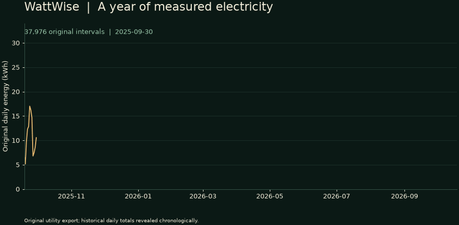
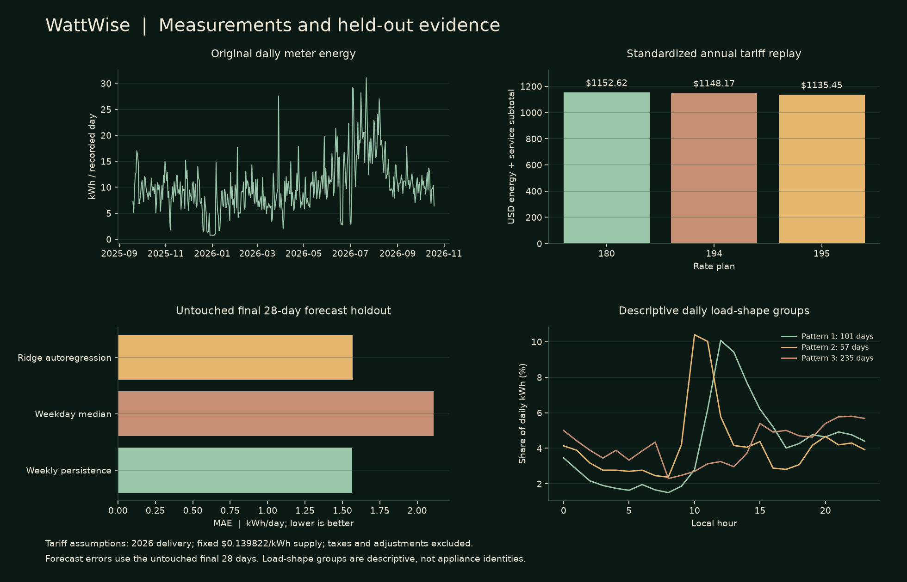

<p align="center"></p>

<h1 align="center">WattWise</h1>

<p align="center">
  <a href="https://github.com/FaiyazEnayet/wattwise/actions/workflows/ci.yml"></a>
  <a href="LICENSE"></a>
  
  
</p>

<p align="center">
  <a href="https://faiyazenayet.github.io/wattwise/docs/dashboard.html"></a>
  <a href="docs/methodology.md"></a>
  <a href="#run-locally"></a>
</p>

WattWise studies my household's electricity use and asks which change is worth making, and what evidence would show that it saved money. It uses 37,976 real fifteen-minute smart-meter readings, 13 detailed utility bills, an additional earlier bill and matched town-level weather. Original measurements, reconstructed accounting, forecasts and counterfactual scenarios remain distinct.

<p align="center"><a href="https://faiyazenayet.github.io/wattwise/docs/dashboard.html"></a></p>

## Explore

- **Meter history:** filter all recorded days, switch between energy and demand, and inspect original quarter-hour readings.
- **Bill laboratory:** reconcile end-exclusive periods, separate service from usage-linked charges, and explain bill changes with exact Shapley attribution.
- **Tariff regret:** replay the same year under Rates 180, 194 and 195 with an editable supply assumption; inspect monthly gains and losses against Rate 194.
- **Savings frontier:** combine declared removable watts with bounded peak shifting, conserve shifted energy and avoid counting the same reduction twice.
- **Task scheduler:** find a contiguous quarter-hour cycle between an earliest start and a deadline from user-entered power and duration.
- **Measurement value:** compare acting with doing nothing under declared savings scenarios, and calculate the perfect-information ceiling before paying to resolve uncertainty.
- **Cooling analysis:** compare daily energy with ERA5 weather, inspect uncertainty and check performance against a held-out baseline.
- **Forecast evaluation:** compare weekly persistence, a weekday median and regularized autoregression with chronological selection and a separate final holdout, including 7-, 14- and 28-day cumulative errors with explicit sample counts.
- **Intervention notebook:** log real changes and confounders, then compare complete days and earlier weather/weekday matched controls when overlap permits. Import and export local records.

## Evidence



| Check | Current evidence |
|---|---|
| Original export | 37,976 intervals; 4,086.55 kWh; September 19, 2025 through October 19, 2026 at 14:45 |
| Shorter export | 2,940 rows matching the longer export; not appended |
| Full detailed billing periods | 12, all within 0.5% of billed energy after correcting the end boundary and using line-item totals |
| Bill reconstruction | Maximum unrounded difference about $0.005136 over 13 detailed bills, using their stored inputs |
| Standardized annual Rate 194 subtotal | $1,148.17 energy plus service under declared replay assumptions |
| Cheapest replay alternative | Rate 195 at $1,135.45, only $12.71 below Rate 194; excludes adjustments and does not establish actual enrollment savings |
| Final 28-day forecast MAE | Weekly persistence 1.564; selected autoregression 1.568 kWh/day |
| Neural benchmark, final 28-day MAE | 2.091 kWh/day; wins the selection window but loses the final holdout to weekly persistence (1.564) and autoregression (1.568) |
| Cooling conditional holdout MAE | 2.744 kWh/day versus 1.846 for the weekday baseline; the cooling model loses |

The billing audit changed the interpretation of an apparent data-quality problem. An earlier reconciliation included the next billing period's first day and compared some periods against chart-read estimates. Correcting the boundary and using the later detailed extraction removes most of the discrepancy. The original readings are retained rather than rescaled to make the accounting agree. The household uses individual room AC units and has no EV. Assumptions stay editable, model failures remain visible, and small or uncertain savings receive the same scrutiny as large ones.

The forecast results impose useful restraint. Autoregression wins the earlier selection window, but weekly persistence is slightly better on the final holdout. The cooling fit finds a temperature association yet loses its predictive comparison. 

A small neural forecaster has now been benchmarked on the same protocol: it won the selection window but lost the final holdout, so it stays a candidate and is not used.

## Architecture

`src/wattwise/decision_analysis.py` owns the audited full-history pipeline. `dashboard_ui/decisions.js` contains pure, independently tested browser arithmetic. `scripts/make_dashboard.py` embeds the frozen report, Plotly and bundled Sora/IBM Plex Mono fonts once. Native controls, visible focus, bounded table scrolling, responsive layouts and reduced-motion rules work without a frontend build framework.

The existing `wattwise insights` command and legacy modules remain available. Their heuristic bands and seeded experiments are separate from the chronological evaluation in the new dashboard. `demo/analysis.json` is the source for the new interface.

## Run locally

```sh
python -m pip install -e ".[dev]"
python -m wattwise analyze --root . --out demo/analysis.json
python scripts/make_dashboard.py
python -m pytest tests -q
node --test tests/test_dashboard_math.cjs
```

Open `docs/dashboard.html` directly. Its core analysis works offline. Optional explicit refreshes:

```sh
python scripts/fetch_household_weather.py --latitude <lat> --longitude <lon>  # coordinates are private
python scripts/make_dashboard.py
python scripts/make_research_assets.py
```

Weather metadata records its provider and date range; exact request parameters stay private. No live meter connection, daily scraping, cloud synchronization or appliance automation is enabled. The `--reuse-analysis` flag is for UI-only changes; omit it after changing data or calculations.

## Data and reproducibility

`demo/pseg_interval_15min.csv` stores interval kWh and average kW. `demo/pseg_rates_detailed.csv` supplies actual rates and accounting components. `demo/pseg_bills.csv` retains the longer history and earlier source estimates. `demo/pseg_appliance_estimates.csv` contains utility dollar estimates. `demo/household_weather.csv` contains modeled weather, and `demo/analysis.json` records results and the input fingerprint. The [methodology](docs/methodology.md) defines source precedence, calendar boundaries, counterfactual assumptions and validation protocols.

## Limitations

- One household and roughly one seasonal cycle do not establish population generalization.
- CSV timestamps lack UTC offsets and a repeated-hour flag. Both DST transition days are excluded from daily models pending utility confirmation; original billing sums remain inspectable.
- Alternative tariffs use the 2026 delivery schedule, a fixed editable supply assumption and calendar-month blocks. Taxes, adjustments, eligibility and actual billing-cycle block proration are excluded.
- Flexible energy and removable watts are assumptions. Aggregate scenarios do not identify appliance jobs or prove comfort feasibility. The separate task scheduler does not reserve circuit capacity or operate devices.
- Utility appliance costs are estimates. Weather associations and observational intervention comparisons do not establish causal appliance savings.
- Forecast bands are empirical. One-step daily accuracy is not multiday accuracy; the open-bill envelope is not a calibrated monthly interval.
- Solar, fuel-switching and EV economics require additional data and are not included in the decision results.

## License

[MIT](LICENSE). Utility exports, weather data, bundled fonts and dependencies retain their respective terms. Weather provenance and attribution are recorded in the metadata.
