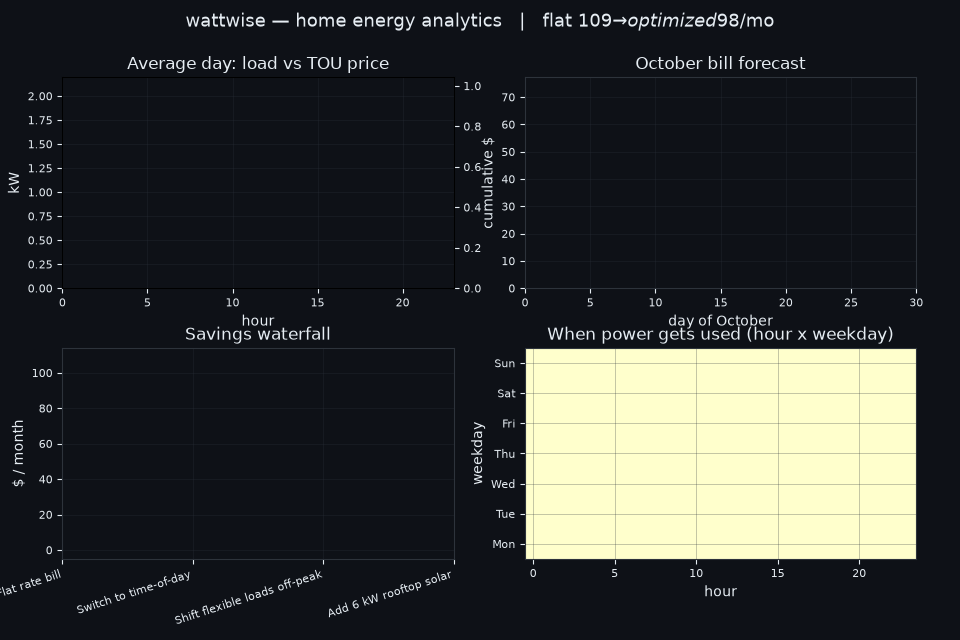
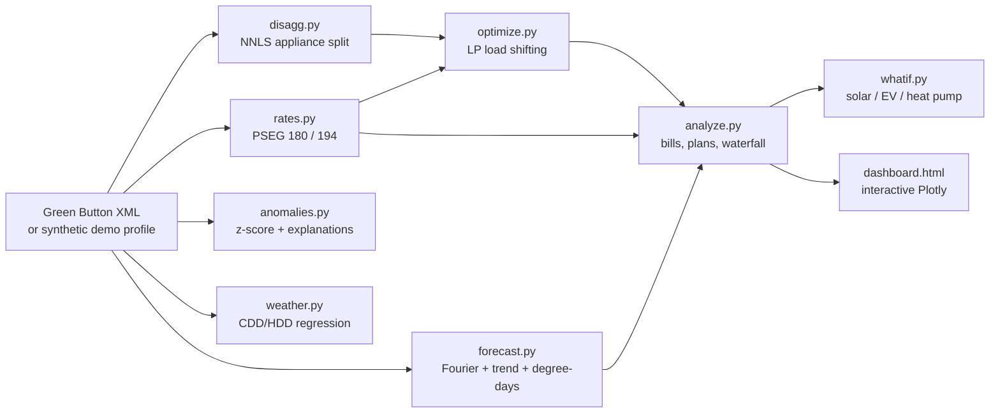

# wattwise

[](tests/)
[](pyproject.toml)
[](LICENSE)
[](#how-it-works)

Home energy analytics for a Long Island house on PSEG. It answers three questions: what will my bill be this month, what is driving it, and how much could I save by shifting flexible loads off peak.

## Live interactive demo

**[Open the interactive dashboard](https://faiyazenayet.github.io/wattwise/docs/dashboard.html).** Load curves, bill forecast with bands, the TOU heatmap, the savings waterfall, appliance breakdown, weather correlation, and what-if scenarios. One self-contained HTML file, no server needed.




## What it does

**Bill forecast.** A time-series model (trend + day-of-week effects + weekly Fourier terms + heating/cooling degree-days, fit by least squares) projects the rest of the month from partial data, with honest 80% prediction bands. On a 7-day backtest against held-out demo data it landed within 4.81%.

**Time-of-use vs flat, for real.** Both PSEG Long Island residential rates are modeled from the published tariff: Rate 194 (time-of-day, the standard rate since January 2024, peak weekdays 3-7 PM) and Rate 180 (optional flat). On the demo house, time-of-day wins by $6.22 a month before any behavior change. Only 13.5% of energy falls in peak hours, but it causes 25.8% of the energy cost.

**Load-shifting optimizer.** Flexible appliances (dishwasher, laundry, water heater) do not care when they run. A linear program reschedules them to the cheapest feasible hours under the TOU rate: same work done, lower bill. Measured savings on the demo profile: **$5.18/month (6.21%)**, shifting 151.7 kWh off peak.

**Appliance disaggregation.** From the whole-house meter alone, a non-negative least-squares split estimates each appliance's daily share. Mean error 1.17 kWh/day per appliance on the demo data, learned from the household's own history.

**Anomaly radar.** Days far from the household's same-weekday baseline get flagged and explained in plain words. Example from the demo: "Friday Oct 02 ran 91% hot: an extra 10.0 kWh, peaking 6 PM-7 PM. Looks like laundry, water heater, cooking."

**Weather correlation.** Daily usage regressed on degree-days: temperature explains 57% of day-to-day variance here, at 1.273 kWh per cooling degree-day and 0.415 per heating degree-day.

**What-if scenarios.** Solar (6 kW, $40.25/month off the bill), EV (30 miles/day charged overnight, 6.5 cents a mile in fuel), heat pump (COP 3.0 heating load). Every assumption is printed next to the result.

**Green Button import.** PSEG's portal exports your real interval data as Green Button XML. `read_greenbutton_xml` turns it into an hourly series, and the whole pipeline runs on it. The demo ships with synthetic data so everything works out of the box; the importer is what makes it real-world usable.

## How it works



## Measured results

Trailing 30 days of the demo profile (seed 7, calibrated so the flat-rate bill lands at $109.01):

| Metric | Value |
|---|---|
| Flat bill (Rate 180), 30 days | $109.01 |
| Time-of-day bill (Rate 194), 30 days | $102.79 |
| Cheaper plan as-is | Time-of-day, by $6.22 |
| Optimizer savings | $5.18/month (6.21%), 151.7 kWh shifted |
| Forecast backtest error (7 days held out) | 4.81% |
| October bill forecast | $84.26 ($73.75 - $94.76 band) |
| Disaggregation MAE | 1.17 kWh/day per appliance |
| Weather R-squared | 0.57 |
| Solar (6 kW) monthly saving | $40.25, ~34 year simple payback |
| EV (30 mi/day) added cost | $58.08/month, 6.5 cents/mile |
| Heat pump (COP 3.0) added cost | $43.81/month |
| Tests | 55 passing |

Every number above comes from `demo/metrics.json`, which `scripts/build_demo.py` writes from actual runs. Nothing here is hand-typed.

## Quickstart

```bash
python -m venv .venv && .venv/bin/pip install -e ".[dev]"
PYTHONPATH=src .venv/bin/python scripts/build_demo.py      # demo data + metrics
PYTHONPATH=src .venv/bin/python scripts/make_dashboard.py # docs/dashboard.html
PYTHONPATH=src .venv/bin/python scripts/make_demo_gif.py  # docs/demo.gif
PYTHONPATH=src .venv/bin/python -m pytest tests/ -q       # 55 tests
```

Bring your own data:

```python
from wattwise import read_greenbutton_xml, Rate194, monthly_bill

hourly = read_greenbutton_xml("pseg_export.xml")  # hourly kWh series
print(monthly_bill(hourly, Rate194()))
```

## Project layout

- `src/wattwise/rates.py`: PSEG LI Rate 180/194 from the published tariff
- `src/wattwise/greenbutton.py`: Green Button XML importer
- `src/wattwise/profile.py`: synthetic demo load + weather generator
- `src/wattwise/forecast.py`: Fourier/trend/degree-day forecaster
- `src/wattwise/disagg.py`: NNLS appliance disaggregation
- `src/wattwise/anomalies.py`: spike detection with explanations
- `src/wattwise/weather.py`: degree-day regression
- `src/wattwise/optimize.py`: LP load-shifting optimizer
- `src/wattwise/whatif.py`: solar, EV, heat pump scenarios
- `src/wattwise/analyze.py`: bill math, plan comparison, waterfall
- `scripts/`: demo builder, dashboard builder, GIF renderer
- `demo/`: synthetic profile, weather, and measured metrics
- `docs/`: dashboard.html and demo.gif
- `tests/`: 55 tests

## Limitations

The demo data is synthetic: a seeded end-use model calibrated so the flat bill hits $109.01, not a real house. Real analysis starts when you import your own Green Button export. Rate parameters track PSEG LI's published tariff with the power-supply charge defaulting to the October 2026 published figure ($0.1392/kWh); it floats monthly, so pass your bill's figure for exactness. The forecaster assumes the recent pattern holds and degrades around vacations or new large loads. Disaggregation is approximate (about 1.2 kWh/day per appliance here); it attributes, it does not meter. The optimizer keeps comfort fixed and never curtails load, only reschedules flexible appliances. What-if scenarios are planning estimates with stated assumptions, not quotes: solar payback is annualized from a single October month, and net metering is modeled conservatively with no export credit. Rate 195 (super off-peak) is not modeled.
