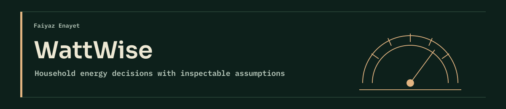
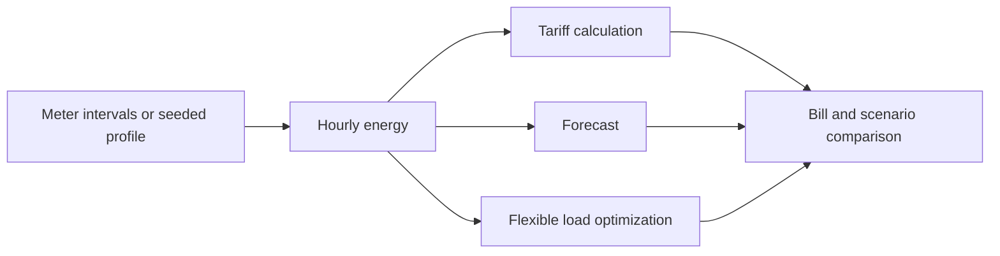

<p align="center"></p>

[](https://github.com/FaiyazEnayet/wattwise/actions/workflows/ci.yml) [](LICENSE)   [](https://faiyazenayet.github.io/wattwise/docs/dashboard.html)

<p align="center"><a href="https://faiyazenayet.github.io/wattwise/docs/dashboard.html"><b>Open interactive demo</b></a> · <a href="docs/dashboard.html">HTML file</a> · <a href="#method">Method</a> · <a href="#run-locally">Run locally</a> · <a href="#limitations">Limitations</a></p>

# WattWise

WattWise explores where a household uses electricity and which modeled changes reduce its bill. It combines load profiles, tariff calculations, forecasts, appliance estimates and constrained load shifting.

**Python · tariff arithmetic · forecasting and optimization**

[](https://faiyazenayet.github.io/wattwise/docs/dashboard.html)


## Explore

- Compare original and optimized load with tariff and usage heatmaps.
- Inspect bill forecast bands, appliance estimates and the savings waterfall.
- Switch source what-if scenarios without presenting estimates as household measurements.

## Method

Hourly usage is priced under flat and time-of-use tariffs. A load-shifting optimizer reschedules flexible appliances without curtailing energy. Forecasts and scenario results are generated by the existing engine, with seeded data labeled as simulated.

## Evidence at a glance

| Scope | Recorded result or contract |
| :--- | :--- |
| Seeded 30-day demo, flat / TOU bill | $109.01 / $102.79 |
| Flexible-load shifting saving | $5.18; 6.21% of flexible-load cost |
| October forecast | $84.26; source band $73.75 to $94.76 |
| Scenario scope | Solar, EV and heat-pump figures are planning estimates |

## Run locally


```sh
python -m pip install -e ".[dev]"
python -m pip install -r portfolio_ui/requirements.txt
python -m pytest tests -q
python scripts/build_demo.py
python scripts/make_dashboard.py
```

## Technical design

The pipeline separates usage, tariff arithmetic, forecasting, load shifting and what-if scenarios. Optimization changes the timing of flexible demand while retaining its energy and comfort constraints. Appliance disaggregation attributes usage approximately; it is not a set of physical submeter readings.



## Evaluation protocol

The shipped household and weather profiles are seeded. Forecast error and savings are computed from that generated profile. Tariff comparisons depend on current supply charges, and forecast bands should be evaluated for coverage rather than treated as guaranteed future bills. Real-meter import also needs the interval and timezone fixes identified in the review.


The 6.21% shifting figure uses flexible-load cost as its denominator, not the entire household bill. Solar, EV and heat-pump scenarios are separate planning cases. Their values should not be summed into one promised saving.

## Code and data

`src/wattwise/` separates import, tariffs, forecasts, optimization and scenarios. `demo/metrics.json` holds computed demo results. `greenbutton.py` imports external interval data.


## Limitations

- The provided household profile is seeded, not a metered home.
- Tariff supply charges change; scenario outputs depend on their stated assumptions.
- The Green Button importer needs overlap-based interval allocation and an explicit household timezone before broader real-meter use.

## License

[MIT](LICENSE). Third-party datasets, libraries and fonts retain their own terms.
