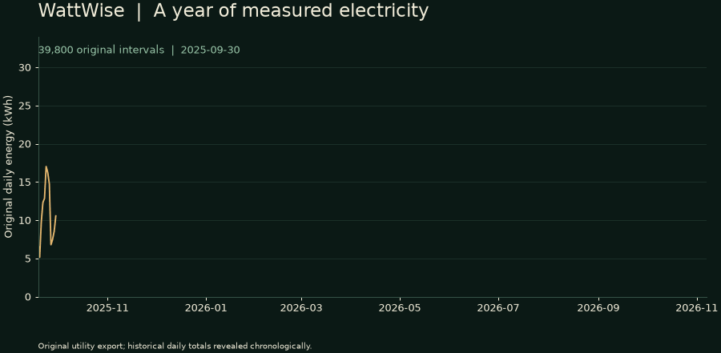
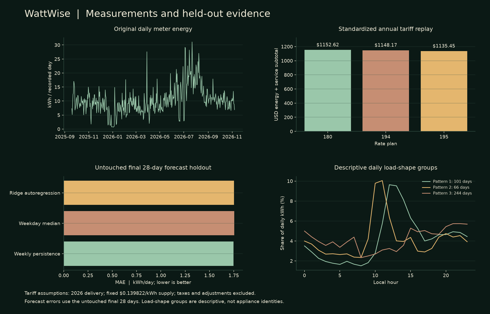

<p align="center"></p>

<h1 align="center">WattWise</h1>

<p align="center">
  <a href="https://github.com/FaiyazEnayet/wattwise/actions/workflows/ci.yml"></a>
  <a href="LICENSE"></a>
  
  
</p>

<p align="center">
  <a href="https://faiyazenayet.github.io/wattwise/docs/dashboard.html"></a>
  <a href="docs/methodology.md"></a>
  <a href="#run-locally"></a>
</p>

WattWise studies my household's electricity use and asks which change is worth making, and what evidence would show that it saved money. It uses 39,800 real fifteen-minute smart-meter readings, 13 detailed utility bills, an additional earlier bill and matched town-level weather. Original measurements, reconstructed accounting, forecasts and counterfactual scenarios remain distinct.

<p align="center"><a href="https://faiyazenayet.github.io/wattwise/docs/dashboard.html"></a></p>

## Explore

- **Overview and meter history:** inspect the open-bill planning forecast, filter recorded days, switch between energy and demand, and inspect original quarter-hour readings and weekday load patterns.
- **Bill laboratory:** reconcile end-exclusive periods, separate service from usage-linked charges, and explain bill changes with exact Shapley attribution.
- **Tariff regret:** replay the same year under Rates 180, 194 and 195 with an editable supply assumption; inspect monthly gains and losses against Rate 194.
- **Savings frontier:** combine declared removable watts with bounded peak shifting, conserve shifted energy and avoid counting the same reduction twice.
- **Task scheduler:** find a contiguous quarter-hour cycle between an earliest start and a deadline from user-entered power and duration.
- **Measurement value:** compare acting with doing nothing under declared savings scenarios, and calculate the perfect-information ceiling before paying to resolve uncertainty.
- **Cooling and patterns:** compare daily energy with ERA5 weather, inspect uncertainty and held-out errors, test a declared AC-use scenario, and inspect daily load-shape groups, residual outliers and utility appliance cost estimates.
- **Forecast evaluation:** compare weekly persistence, a weekday median and regularized autoregression with chronological selection and a separate final holdout, including 7-, 14- and 28-day cumulative errors with explicit sample counts.
- **Evidence and intervention notebook:** inspect the source audit, log changes and confounders, then compare complete days with earlier weather/weekday-matched controls when overlap permits. Import and export local records.

## Evidence



| Check | Current evidence |
|---|---|
| Original export | 39,800 intervals; 4,264.91 kWh; September 19, 2025 through November 7, 2026 at 14:45 |
| Detailed bills and interval coverage | 13 detailed bills; 12 fully covered by the interval export, all within 0.5% of billed energy. The September 3 to October 2, 2025 bill starts before the export and has partial interval coverage. |
| Billing history | 15 issued bills: the 13 detailed bills, one earlier history-only bill, and the October 2026 bill documented by its bill email and portal breakdown. |
| Bill reconstruction | Maximum unrounded difference about $0.005136 over 13 detailed bills, using their stored inputs |
| Standardized annual Rate 194 subtotal | $1,148.17 energy plus service under declared replay assumptions |
| Cheapest replay alternative | Rate 195 at $1,135.45, only $12.71 below Rate 194; excludes adjustments and does not establish actual enrollment savings |
| Final 28-day forecast MAE | Weekly persistence 1.749; selected autoregression 1.753 kWh/day |
| Separate neural benchmark, final 28-day daily MAE | 2.091 kWh/day, conditional on realized weather; below the baselines on the reported selection MAE but above weekly persistence (1.749) and autoregression (1.753) on the final holdout. |
| Separate forecast tournament decision | Weekly persistence retained under the recorded adoption rule. Ridge, constrained tree, neural and ensemble have higher cumulative MAE at both the 7- and 14-day holdout horizons under the no-future-weather protocol. |
| Cooling conditional holdout MAE | 1.990 kWh/day versus 1.544 for the weekday baseline; the cooling model loses |

Money subtotals are shown to cents and MAEs to three decimal places. The $12.71 tariff difference uses the unrounded report subtotals, rather than subtracting the displayed rounded amounts. The bill reconstruction difference is rounded to six decimal places.

The billing audit changed the interpretation of an apparent data-quality problem. An earlier reconciliation included the next billing period's first day and compared some periods against chart-read estimates. Correcting the boundary and using the later detailed extraction removes most of the discrepancy. The original readings are retained rather than rescaled to make the accounting agree. The household uses individual room AC units and has no EV. Assumptions stay editable, model failures remain visible, and small or uncertain savings receive the same scrutiny as large ones.

The forecast results impose useful restraint. Autoregression wins the earlier selection window, but weekly persistence is slightly better on the final holdout. The cooling fit finds a temperature association yet loses its predictive comparison. 

The separate neural benchmark in `demo/neural_forecast.json` uses realized target-day weather, so it is a conditional benchmark rather than a forecast using only information available in advance. It has the lowest reported one-step selection MAE but loses on the final holdout. `demo/forecast_tournament.json` evaluates a separate no-future-weather protocol and records a decision to retain weekly persistence. Neither benchmark is embedded in the shipped dashboard. Its frozen report still selects `ridge_ar` on the earlier selection window; the separate tournament verdict does not replace that report selection.

## Architecture

`src/wattwise/decision_analysis.py` builds the full-history report. `dashboard_ui/decisions.js` contains pure, independently tested browser arithmetic. `scripts/make_dashboard.py` embeds the frozen report, Plotly and bundled Sora/IBM Plex Mono fonts once. The interface uses native controls, visible focus styles, bounded table scrolling, responsive CSS and reduced-motion rules without a frontend build framework.

The existing `wattwise insights` command and legacy modules remain available. Their heuristic bands and seeded experiments are separate from the chronological evaluation in the new dashboard. `demo/analysis.json` is the source for the new interface.

## Run locally

```sh
python -m pip install -e ".[dev]"
python -m wattwise.cli analyze --root . --out demo/analysis.json
python scripts/make_dashboard.py
python -m pytest tests -q
node --test tests/test_dashboard_math.cjs
python scripts/verify_frozen_outputs.py
```

Open `docs/dashboard.html` directly. Its core analysis works offline. Optional explicit refreshes:

```sh
python scripts/fetch_household_weather.py --latitude <lat> --longitude <lon>  # coordinates are private
python scripts/make_dashboard.py
python scripts/make_research_assets.py
```

Weather metadata records its provider and date range; exact request parameters stay private. No live meter connection, daily scraping, cloud synchronization or appliance automation is enabled. For presentation-only changes, `python scripts/make_dashboard.py --reuse-analysis` uses the stored report only when its manifest digest matches the current inputs, pricing assumptions and analysis code. It refuses reuse when the manifest is missing or the digest differs. Rebuild without that flag after changing those inputs or rules.

## Use it on another household

The report above is one household's. The `wattwise.household` module generalizes the pipeline: documented, validated schemas for interval and bill CSVs that stay in private local files, a uniform tariff interface (declared flat and time-of-use tariffs, plus the existing Rate 194), and a `wattwise household` command that summarizes a home from its own files. Reports keep within-home results per household and cross-home aggregates separate, and never pool intervals across homes. Public CI exercises this path on a small synthetic fixture (two invented households from a declared seeded process in `wattwise.synthetic`, with a generated example report), so no real household's files are needed to test it. See [the generalized pipeline guide](docs/generalized-pipeline.md) for the schemas and a worked example.

## Data and reproducibility

`demo/pseg_interval_15min.csv` stores interval kWh and average kW. `demo/pseg_rates_detailed.csv` supplies actual rates and accounting components. `demo/pseg_bills.csv` retains the longer history and earlier source estimates. `demo/pseg_appliance_estimates.csv` contains utility dollar estimates. `demo/household_weather.csv` contains Open-Meteo ERA5 reanalysis rather than home-sensor measurements; its provider, date range and units are in `demo/household_weather.metadata.json`. `demo/analysis.json` contains the results and a full evidence manifest: input paths, hashes, row counts and parser/timestamp conventions; pricing assumptions and tariff version; an analysis-code fingerprint; a manifest digest; and build annotations for the environment and Git revision. Build annotations are excluded from the reuse digest. The [methodology](docs/methodology.md) defines source precedence, calendar boundaries, counterfactual assumptions and validation protocols.

The normal `python scripts/verify_frozen_outputs.py` check compares the report at nine significant digits after normalizing its build annotations, and checks the dashboard structure and application code with the embedded payload and Plotly bundle masked out. The current artifacts pass that check. The committed dashboard payload predates the November 2026 data update and is refreshed through the dashboard batch; the committed report and its manifest are current. The optional `--strict` dashboard byte comparison fails across the checked environments because build metadata and unrounded numerical values differ. Byte-exact dashboard reproducibility is not claimed.

## Limitations

- One household and roughly one seasonal cycle do not establish population generalization.
- CSV timestamps lack UTC offsets and a repeated-hour flag. Both DST transition days are excluded from daily models pending utility confirmation; original billing sums remain inspectable.
- Alternative tariffs use the 2026 delivery schedule, a fixed editable supply assumption and calendar-month blocks. Taxes, adjustments, eligibility and actual billing-cycle block proration are excluded.
- Flexible energy and removable watts are assumptions. Aggregate scenarios do not identify appliance jobs or prove comfort feasibility. The separate task scheduler does not reserve circuit capacity or operate devices.
- Utility appliance costs are estimates. Weather associations and observational intervention comparisons do not establish causal appliance savings.
- Forecast bands use empirical residuals. One-step daily accuracy is not multiday accuracy; the open-bill envelope is not a calibrated monthly interval. Forecast origins overlap. In the current data every 28-day holdout window crosses the excluded November DST day, so the 28-day cumulative holdout metrics are null rather than estimated from incomplete windows.
- Solar, fuel-switching and EV economics require additional data and are not included in the decision results.

## License

[MIT](LICENSE). Utility exports, weather data, bundled fonts and dependencies retain their respective terms. Weather provenance and attribution are recorded in the metadata.
