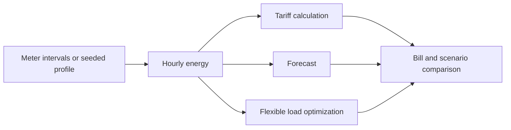
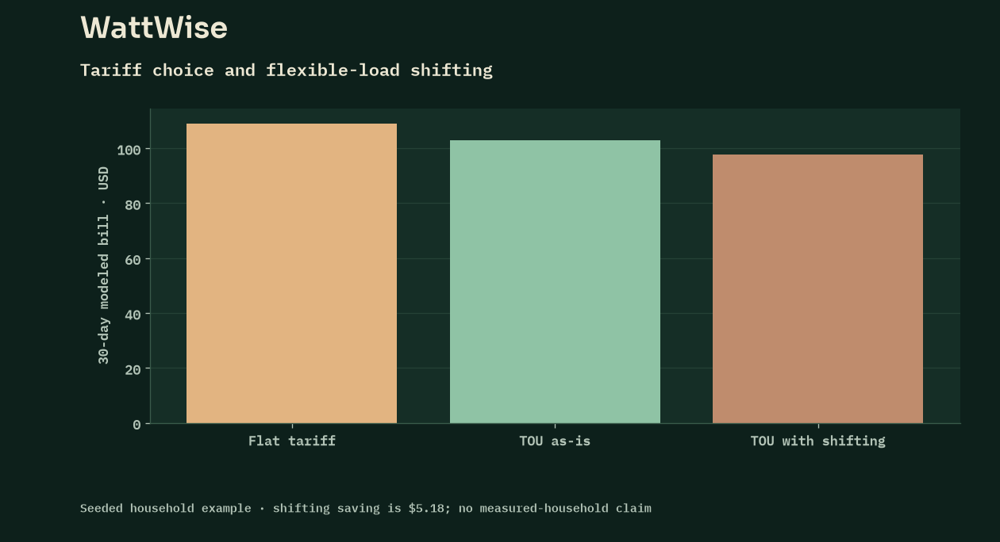

<p align="center"></p>

[](https://github.com/FaiyazEnayet/wattwise/actions/workflows/ci.yml) [](LICENSE)   [](https://faiyazenayet.github.io/wattwise/docs/dashboard.html)

<p align="center"><a href="https://faiyazenayet.github.io/wattwise/docs/dashboard.html"><b>Open interactive demo</b></a> · <a href="#method">Method</a> · <a href="#run-locally">Run locally</a></p>

# WattWise

WattWise explores where my household uses electricity and which changes reduce the bill. It is trained on my own real smart-meter data: 13 months, 37,976 fifteen-minute readings from my home, plus 14 exact utility bills. Load profiles, tariff calculations, forecasts, appliance estimates and constrained load shifting all run on those measurements.


[](https://faiyazenayet.github.io/wattwise/docs/dashboard.html)


A lower bill can come from moving demand to cheaper hours without reducing total energy use. Compare the optimized load profile with the tariff schedule and appliance constraints before interpreting savings. Forecast bands and weather relationships provide context for uncertainty, while the seeded household profile keeps the example reproducible. Real measured billing history for the same utility now ships in `demo/` and is reported under Measured data below.

## Explore

- Compare original and optimized load with tariff and usage heatmaps.
- Inspect bill forecast bands, appliance estimates and the savings waterfall.
- Switch source what-if scenarios without presenting estimates as household measurements.

## Method

Hourly usage is priced under flat and time-of-use tariffs. A load-shifting optimizer reschedules flexible appliances without curtailing energy. Forecasts and scenario results are generated by the existing engine, with seeded data labeled as simulated.

## Evidence at a glance

| Scope | Recorded result or contract |
| :--- | :--- |
| Seeded 30-day demo, flat / TOU bill | $109.01 / $99.95 |
| Flexible-load shifting saving | $3.14; 3.75% of flexible-load cost |
| October forecast | $85.33; source band $78.24 to $92.42 |
| Measured Sep 2026 period | 320.25 kWh; actual bill $109.01; $19 peak cost |
| Scenario scope | Solar, EV and heat-pump figures are planning estimates |

## Measured data

The repo ships real measured billing history in `demo/pseg_bills.csv`, `demo/pseg_monthly.csv` and `demo/pseg_appliance_estimates.csv`, taken from PSEG Long Island utility emails and the utility's customer portal with all identifying fields stripped. The portal's bill history gives fourteen exact bills from Aug 2025 to Oct 2026 totaling $1,493.31, with exact bill dates and days-in-bill; period dates chain backward from the known Jul 2026 anchor. The portal's yearly energy chart adds monthly kWh for twelve periods, 2,400 kWh across nine chart-estimated periods plus measured totals for Jul (619.39), Aug (427.24) and Sep (320.25) 2026 from the weekly usage summaries; differencing their cumulative snapshots yields 12 measured sub-period increments (`demo/pseg_subperiod.csv`, Jul 2 to Oct 17 2026), and tariff facts from utility emails sit in `demo/pseg_rates.csv`. Chart-read values are labeled as estimates in the CSVs, not measurements. The bill detail pages add `demo/pseg_rates_detailed.csv`: the exact delivery and power-supply rates (peak and off-peak), service and MFC charges, DER rate and tax totals for 13 billed periods, transcribed line-by-line. The portal's demand chart adds `demo/pseg_daily_oct2026.csv`: daily peak demand for Oct 5-19 2026 (highest 3.72 kW on Oct 9) with the average temperature curve, plus the portal's own Oct 18 daily total (10.38 kWh, 22% below its 90-day average). The portal's bill comparisons add the Aug 2025 period's measured 472 kWh, the Jan 2026 appliance estimates, and the Aug 2026 appliance values that reconcile exactly to the portal's $99 energy charges.

The largest dataset is the smart-meter export itself: `demo/pseg_interval_15min.csv` holds a full year of 15-minute intervals (37,976 rows, Sep 19 2025 to Oct 19 2026, 4,086.55 kWh — timestamps, kWh and kW only). `demo/pseg_interval_validation.csv` reconciles it against the bills: interval sums per billing period run +0.7% to +3.7% above the billed kWh on full periods (the three exactly-measured periods: +2.2% to +3.1%; the Jan 2026 period is the outlier at +9.6% against a rounded chart estimate), consistent with per-interval rounding in the export. The Rate 194 peak window (weekdays 3-7 PM, federal holidays excluded — the same window the portal's rate-plan page states) applied to the intervals reproduces the utility's billed peak kWh within a few kWh per period (Sep 2026: 40.52 derived vs 39 billed). Seasonal shapes differ sharply: winter averages 7.1 kWh/day peaking mid-afternoon, summer 15.3 kWh/day with 29% of use between midnight and 6 AM (overnight cooling), spring 8.9, fall 10.0. One earlier portal day is kept separately in `demo/pseg_hourly_oct17.csv`: the hourly costs for Saturday Oct 17 2026, the first real intraday shape obtained, against which the seeded generator's windows were corrected (its Saturday had stacked 47% of the day into 5-9 PM; the real day spreads across a 1 PM peak, a smaller 8 PM peak and a long late-night tail).

The household is strongly seasonal, and the model now anchors to that pattern rather than to September alone: usage peaks in the Aug 2026 period at 619.39 kWh (about 74°F average) and bottoms out in the Dec-Jan period at about 195 kWh (about 32°F), a 3.2x summer-to-winter swing that tracks the chart's temperature curve.

The September 2026 period is fully specified by the portal's monthly summary: 320.25 kWh, $109.01 on Time-of-Day Rate 194, split 281 kWh off-peak ($63) and 39 kWh peak ($19), with $82 of energy usage charges and $27 of taxes and fees; peak usage fell 7% versus the prior period, with cooling (30%) and always-on (13%) the top peak contributors. The utility's own insights put this household's cooling 53% below similar homes and its always-on load 35% above its typical usage. `demo/real_metrics.json` runs the full engine on a profile for that period built from the actual 15-minute intervals (each covered day keeps its own measured hourly shape; Sep 2-18 use the measured fall average shape), with day totals anchored to the measured sub-period trend. Period totals, the appliance mix, the bill and the intraday shape are measured; only the appliance split within each hour is modeled (no submetered end-use data exists).

What the measured data says, with no adjustment:

| Measure | Value |
| :--- | :--- |
| Measured kWh, Sep 2026 | 320.25 (10.68 kWh/day) |
| Actual bill (Rate 194) | $109.01 |
| Modeled bill on the same usage | $97.49 TOU / $102.22 flat |
| Modeled load-shifting saving | $0.58 (0.71%), 89.5 kWh shifted |
| Real end-use mix (utility estimate) | HVAC 22.1%, baseload 21.9%, laundry 19.4%, lighting+plug 17.1%, cooking 11.0%, water heater 7.6%, dishwasher 1.0% |
| Seeded demo end-use mix | water heater 32.5%, HVAC 28.5%, lighting+plug 10.9%, baseload 9.9%, cooking 7.7%, laundry 6.1%, dishwasher 4.4% |

Two honest findings. First, the tariff model built from the published rate approximations prices the measured month $11.52 below the actual bill, the gap expected from taxes, fees and supply-rate timing the model does not carry. With the exact rates from the bill detail pages (`Rate194History` in `wattwise.rates`) that gap disappears: the model now reproduces all 13 measured bills with a worst error of $0.0051, about half a cent of the utility's own per-line rounding. Second, the measured end-use mix disagrees with the synthetic demo: in the real Sep period baseload, HVAC and laundry dominate, while the seeded profile put a third of all energy into water heating. The demo keeps its seeded profile as the reproducible example; the measured numbers are the ground truth to compare against. A third finding came with the optimizer's move to the real interval shape: load-shifting savings fell from $1.12 on the seeded shape to $0.58, because the real household puts less energy in the weekday peak window than the seeded profile assumed.

## Insights engine

`wattwise insights` (module `wattwise.insights`) turns the measured data into decisions, using the exact per-period rates rather than the published approximations:

- **Bill forecast**: the next 30-day bill projected from the trailing interval total scaled by last year's seasonal factor. Latest run: $99.13 (range $84.26 to $113.99) on 283.8 projected kWh.
- **Peak-hour drift**: the latest period's peak share against the three-period baseline. Latest run: 12.2% vs a 10.3% baseline, flagged as drift (+18.6%), a $1.64 cost impact at current rates.
- **What-if scenarios**: peak shifting, cooling cuts and total cuts repriced exactly. On the anchor period, shifting 20% of peak kWh off-peak saves $2.10; a 20% cooling cut saves $3.63; a 10% total cut saves $8.25.
- **Seasonal outlook**: expected kWh and bill for upcoming months from last year's same-month actuals (December: ~195 kWh, ~$78.47 from the chart estimate).
- **Cost drivers**: end uses ranked by dollars for the anchor period, cooling first ($18), then laundry ($16) and always-on ($12), with the savings from 10% and 20% cuts of each.
- **Anomaly detection**: days more than 2 standard deviations above the rolling 14-day same-weekday mean, with the excess kWh and dollars (31 days flagged across the measured year; the largest single-day excess is 19.26 kWh on 2026-03-29).

## Updating this project

Dashboard source language: **Python**. Generator: `scripts/make_dashboard.py`. The local interactive output is `docs/dashboard.html`.

## Run locally


```sh
python -m pip install -e ".[dev]"
python -m pip install -r portfolio_ui/requirements.txt
python -m pytest tests -q
python scripts/build_demo.py
python scripts/make_dashboard.py
```

## Technical design

The pipeline separates usage, tariff arithmetic, forecasting, load shifting and what-if scenarios. Optimization changes the timing of flexible demand while retaining its energy and comfort constraints. Appliance disaggregation attributes usage approximately; it is not a set of physical submeter readings.



## Evaluation protocol

The shipped household and weather profiles are seeded. Forecast error and savings are computed from that generated profile. Tariff comparisons depend on current supply charges, and forecast bands should be evaluated for coverage rather than treated as guaranteed future bills. Real-meter import also needs the interval and timezone fixes identified in the review.



The 3.75% shifting figure uses flexible-load cost as its denominator, not the entire household bill. Solar, EV and heat-pump scenarios are separate planning cases. Their values should not be summed into one promised saving.

## Code and data

`src/wattwise/` separates import, tariffs, forecasts, optimization and scenarios. `demo/metrics.json` holds computed demo results, `demo/real_metrics.json` holds the measured-period results, and `demo/pseg_bills.csv` plus `demo/pseg_appliance_estimates.csv` hold the measured history. `greenbutton.py` imports external interval data.


## Limitations

- The demo household profile is seeded, not a metered home. The measured section uses real period totals, bills and the real 15-minute interval shape; only the appliance split within each hour is modeled, because no submetered end-use data exists. Interval sums run a few percent above billed kWh (see the validation file); billed figures remain the ground truth for money.
- Tariff supply charges change; scenario outputs depend on their stated assumptions.
- The Green Button importer needs overlap-based interval allocation and an explicit household timezone before broader real-meter use.

## License

[MIT](LICENSE). Third-party datasets, libraries and fonts retain their own terms.
