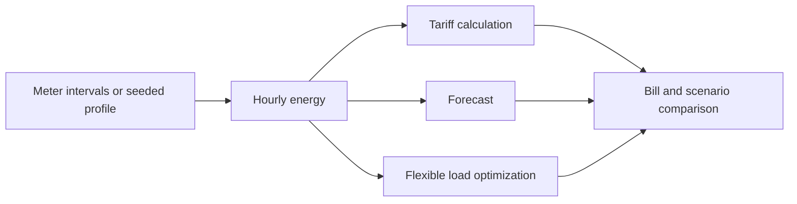

<p align="center"></p>

[](https://github.com/FaiyazEnayet/wattwise/actions/workflows/ci.yml) [](LICENSE)   [](https://faiyazenayet.github.io/wattwise/docs/dashboard.html)

<p align="center"><a href="https://faiyazenayet.github.io/wattwise/docs/dashboard.html"><b>Open interactive demo</b></a> · <a href="#method">Method</a> · <a href="#run-locally">Run locally</a></p>

# WattWise

WattWise explores where a household uses electricity and which modeled changes reduce its bill. It combines load profiles, tariff calculations, forecasts, appliance estimates and constrained load shifting.


[](https://faiyazenayet.github.io/wattwise/docs/dashboard.html)


A lower bill can come from moving demand to cheaper hours without reducing total energy use. Compare the optimized load profile with the tariff schedule and appliance constraints before interpreting savings. Forecast bands and weather relationships provide context for uncertainty, while the seeded household profile keeps the example reproducible. Real measured billing history for the same utility now ships in `demo/` and is reported under Measured data below.

## Explore

- Compare original and optimized load with tariff and usage heatmaps.
- Inspect bill forecast bands, appliance estimates and the savings waterfall.
- Switch source what-if scenarios without presenting estimates as household measurements.

## Method

Hourly usage is priced under flat and time-of-use tariffs. A load-shifting optimizer reschedules flexible appliances without curtailing energy. Forecasts and scenario results are generated by the existing engine, with seeded data labeled as simulated.

## Evidence at a glance

| Scope | Recorded result or contract |
| :--- | :--- |
| Seeded 30-day demo, flat / TOU bill | $109.01 / $101.98 |
| Flexible-load shifting saving | $5.26; 6.13% of flexible-load cost |
| October forecast | $86.80; source band $79.13 to $94.47 |
| Measured Sep 2026 period | 320.25 kWh; actual bill $109.01; $17 peak cost |
| Scenario scope | Solar, EV and heat-pump figures are planning estimates |

## Measured data

The repo ships real measured billing history in `demo/pseg_bills.csv` and `demo/pseg_appliance_estimates.csv`, taken from PSEG Long Island utility emails with all identifying fields stripped. Six billed periods from Feb to Oct 2026 total $715.52; weekly usage summaries give measured kWh for the Jul (619.39), Aug (427.24) and Sep (320.25) 2026 periods.

The September 2026 period is fully specified: 320.25 kWh, $109.01 on Time-of-Day Rate 194, $17 of it peak-hour cost. `demo/real_metrics.json` runs the full engine on a profile calibrated to that period, where period totals, the appliance mix and the bill are measured and only the intraday shape is modeled (seeded).

What the measured data says, with no adjustment:

| Measure | Value |
| :--- | :--- |
| Measured kWh, Sep 2026 | 320.25 (10.68 kWh/day) |
| Actual bill (Rate 194) | $109.01 |
| Modeled bill on the same usage | $101.61 TOU / $102.22 flat |
| Modeled load-shifting saving | $1.12 (1.31%), 89.8 kWh shifted |
| Real end-use mix (utility estimate) | baseload 22.0%, HVAC 22.0%, laundry 19.5%, lighting+plug 17.1%, cooking 11.0%, water heater 7.6%, dishwasher 1.0% |
| Seeded demo end-use mix | water heater 33.9%, HVAC 28.6%, baseload 9.8%, lighting+plug 9.2%, laundry 7.2%, cooking 6.8%, dishwasher 4.4% |

Two honest findings. First, the tariff model prices the measured month $7.40 below the actual bill, the gap expected from taxes, fees and supply-rate timing the model does not carry. Second, the measured end-use mix disagrees with the synthetic demo: in the real Sep period baseload, HVAC and laundry dominate, while the seeded profile put a third of all energy into water heating. The demo keeps its seeded profile as the reproducible example; the measured numbers are the ground truth to compare against.

## Updating this project

Dashboard source language: **Python**. Generator: `scripts/make_dashboard.py`. The local interactive output is `docs/dashboard.html`.

## Run locally


```sh
python -m pip install -e ".[dev]"
python -m pip install -r portfolio_ui/requirements.txt
python -m pytest tests -q
python scripts/build_demo.py
python scripts/make_dashboard.py
```

## Technical design

The pipeline separates usage, tariff arithmetic, forecasting, load shifting and what-if scenarios. Optimization changes the timing of flexible demand while retaining its energy and comfort constraints. Appliance disaggregation attributes usage approximately; it is not a set of physical submeter readings.



## Evaluation protocol

The shipped household and weather profiles are seeded. Forecast error and savings are computed from that generated profile. Tariff comparisons depend on current supply charges, and forecast bands should be evaluated for coverage rather than treated as guaranteed future bills. Real-meter import also needs the interval and timezone fixes identified in the review.


The 6.13% shifting figure uses flexible-load cost as its denominator, not the entire household bill. Solar, EV and heat-pump scenarios are separate planning cases. Their values should not be summed into one promised saving.

## Code and data

`src/wattwise/` separates import, tariffs, forecasts, optimization and scenarios. `demo/metrics.json` holds computed demo results, `demo/real_metrics.json` holds the measured-period results, and `demo/pseg_bills.csv` plus `demo/pseg_appliance_estimates.csv` hold the measured history. `greenbutton.py` imports external interval data.


## Limitations

- The demo household profile is seeded, not a metered home. The measured section uses real period totals and bills, but its intraday shape is still modeled; PSEG email data contains no interval readings.
- Tariff supply charges change; scenario outputs depend on their stated assumptions.
- The Green Button importer needs overlap-based interval allocation and an explicit household timezone before broader real-meter use.

## License

[MIT](LICENSE). Third-party datasets, libraries and fonts retain their own terms.
